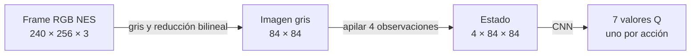
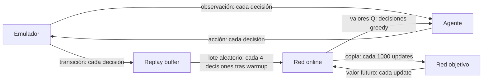
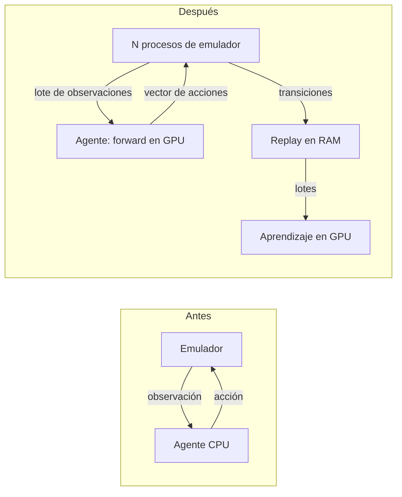

# Entrenamiento del agente DQN: cómo funciona y cómo se aceleró

Este proyecto entrena un agente para el nivel 1-1 de Super Mario Bros. de NES. La red aprende a elegir entre siete acciones predefinidas por el ambiente de entrenamiento y decide a partir de imágenes recientes. El emulador proporciona las recompensas y consecuencias. En este documento explico el ciclo, cómo interpretar sus resultados y las optimizaciones realizadas para aumentar las decisiones por segundo. Los valores predeterminados son los de `TrainConfig` y una ejecución puede sobrescribirlos.

## 1. El problema: qué ve, qué hace y qué gana el agente

El emulador de NES ([nespy](https://github.com/Kautenja/nes-py)) empleado entrega imágenes RGB de **256 × 240 píxeles**. El pipeline de entrenamiento convierte convierte cada frame del juego a escala de grises y se reduce a 84 × 84, conservando formas relevantes con menos datos que procesar. Se apilan cuatro imágenes consecutivas en un tensor de dimensiones `(4, 84, 84)`. Una imagen aislada muestra dónde están Mario y los objetos y la secuencia da pistas sobre su movimiento. Al reiniciar, las cuatro posiciones de la pila contienen la imagen inicial.



Las acciones son:
- nada,
- derecha,
- derecha + salto,
- derecha + correr,
- derecha + correr + salto,
- salto e izquierda.

El espacio de acciones reducido evita aprender combinaciones innecesarias o contradictorias, aunque también limita lo que el agente puede hacer.

La red asigna un valor Q a cada acción. El valor de Q representa una estimación de la recompensa futura y no una probabilidad de éxito.

La recompensa de cada **frame** suma avances nuevos, cambio negativo del reloj (tiempo ahorrado en una _run_ o partida), penalización por muerte y premio por completar el nivel. El avance solo cuenta cuando supera la posición máxima anterior. Los aumentos mayores de cinco píxeles en un frame se ignoran como posibles saltos anómalos.

Morir aporta negativamente (−25) y completar un nivel aporta positivamente (+50). Se suman todos los factores de recompensa y entonces se ajusta la suma al intervalo **[−15, 15]**.

> Esto quiere decir que si la suma de recompensa de un frame es superior a +15, el valor final de la recompensa será 15. Si la suma es inferior a -15, el valor final será -15.

El recorte limita valores extremos para estabilizar el aprendizaje. Premiar la posición absoluta en cada frame recompensaría permanecer lejos del inicio sin avanzar; usar el máximo anterior evita cobrar repetidamente por recorrer el mismo terreno.

Una **decisión** aplica la misma acción hasta cuatro frames por defecto y suma las recompensas de esos frames. LA decisión puede detenerse antes si termina el episodio. Por eso el recorte se aplica por frame, no necesariamente al total de la decisión. La barra y los presupuestos cuentan decisiones, no frames.

## 2. El ciclo de una decisión

1. El agente observa la pila de imágenes y elige una acción con la política *epsilon-greedy*: con probabilidad $\epsilon$ se elige una acción al azar, y con probabilidad $1 - \epsilon$ la acción con el valor Q más alto.
2. El entorno ejecuta la acción repetida y devuelve observación siguiente, recompensa y señales de fin.
3. El replay guarda esa transición. Después del calentamiento, se extraen lotes aleatorios para actualizar la red online. Al mezclar experiencias reduce la correlación entre pasos consecutivos y permite reutilizarlas.
4. La red objetivo proporciona valores futuros más estables. Cada 1.000 actualizaciones del optimizador, por defecto, recibe una copia de los pesos online.



En una ejecución nueva, epsilon es 1 durante las primeras 5.000 decisiones y luego baja linealmente de 1 a 0,05 durante 200.000 decisiones. Así empieza explorando y después usa más lo aprendido, conservando algo de exploración. Por defecto se aprende cada cuatro decisiones, siempre que haya terminado el warmup y exista un lote completo.

Al reanudar se restauran las redes, Adam y sus contadores, pero **no** el replay, la partida ni el estado aleatorio. Se recopilan otras `warmup` decisiones antes de aprender, mientras epsilon sigue el calendario global: no se fuerza de nuevo a 1. Por eso una continuación no reproduce exactamente la ejecución interrumpida. `--steps` indica el objetivo total y la salida debe ser una carpeta nueva. El [README](README.md) contiene comandos de entrenamiento y reanudación.

## 3. Cómo aprende la red: el objetivo de Bellman

Para cada transición, el objetivo calculado en `agent.learn` es:

$$
y = r + \gamma(1 - \text{terminal}) \max_{a'} Q_\text{objetivo}(s', a')
$$

Aquí $r$ es la recompensa de la decisión, $s'$ el estado siguiente, $\gamma = 0,99$ el descuento y $\text{terminal}$ vale 1 si hubo muerte o finalización. El término máximo estima el mejor valor futuro según la red objetivo. Con gamma 0,99, una recompensa un paso más adelante pesa el 99 % de una inmediata. Esto implica que, a más pasos, su peso disminuye multiplicándose por 0,99 cada vez.

La muerte y la bandera son estados que terminan una _run_ y no añaden valor futuro. Un episodio **truncado** por el límite de decisiones se detiene por una restricción externa, por lo que se conserva la estimación futura. La pérdida Huber (smooth L1) compara el Q predicho para la acción tomada con el objetivo: es cuadrática para errores pequeños y lineal para errores grandes, lo que reduce la influencia de errores extremos frente al error cuadrático puro. Adam actualiza la red online y se limita la norma del gradiente a 10.

## 4. Leer los resultados: por qué la x sube y baja

`evaluation.csv` registra `step`, `success_rate`, `mean_reward` y `mean_progress`. Esta última es la media del máximo avance horizontal, no necesariamente la posición final. `best.pt` se selecciona primero por éxito y después por progreso; `final.pt` es simplemente el último. Un mayor avance no demuestra que el nivel esté resuelto.

En NES el reset recupera el mismo estado inicial y la evaluación usa una política greedy sin exploración. Con la misma red y comportamiento determinista, repetir episodios aunque cambie la seed repite la partida; aumentar `--eval-episodes` a 5 no aporta cinco situaciones independientes. La variación entre evaluaciones puede reflejar cambios en los pesos y sus decisiones, no necesariamente ruido de muestreo. La política puede olvidar o empeorar una maniobra mientras aprende otra, así que la curva no tiene por qué subir de forma monótona.

La plantilla original citaba grupos de progreso cerca de 700, 1130, 1420 y 1520, y un `best.pt` con x = 2470 y éxito 0 %. Son datos indicados en la plantilla, no resultados que haya podido comprobar en este árbol: aquí no encontré archivos `runs/*/evaluation.csv`. Tampoco he identificado visualmente los obstáculos ni medido la distancia restante, así que no atribuyo muertes a lugares concretos. Para completar esa parte, grafica `mean_progress` frente a `step` con los CSV de la ejecución y abre checkpoints representativos con `compare --checkpoint ...`; registra capturas y el obstáculo observado antes de dibujar el mapa del nivel.

Una evaluación más informativa podría variar controladamente el inicio, por ejemplo con un número aleatorio de frames sin acción, o introducir un epsilon pequeño. Habría que implementarla y documentar sus seeds y condiciones: mediría robustez ante perturbaciones, no exactamente la misma partida greedy actual. Entrenar varias seeds también permite comparar variación entre modelos.

## 5. Dónde se iba el tiempo

La plantilla recoge este perfil de la máquina de 12 núcleos, para el bucle original. Son mediciones anteriores, no una medición nueva de esta edición:

| Etapa | Tiempo aproximado por decisión |
|---|---:|
| Emular cuatro frames | 4,2 ms |
| Gris y reducción | 0,3 ms |
| Elegir acción | 0,4 ms |
| Aprender: 14,5 ms cada cuatro decisiones | 3,6 ms |
| Total | ~8,5 ms, o ~117 decisiones/s |

```mermaid
xychart-beta
    title "Tiempo aproximado por decisión (ms)"
    x-axis [Emulación, Preprocesado, Acción, Aprendizaje]
    y-axis "ms" 0 --> 5
    bar [4.2, 0.3, 0.4, 3.6]
```

Emulación y aprendizaje dominan juntos. Si la emulación costara cero, el resto dejaría un límite ideal de aproximadamente **233 decisiones/s**; si el aprendizaje costara cero, el límite sería aproximadamente **204 decisiones/s**. Son cálculos ideales con tiempos redondeados, no predicciones de rendimiento real. El emulador ya ejecuta sin esperar a los 60 fps de visualización: no hay una espera de tiempo real que eliminar con un interruptor de «turbo».

## 6. La aceleración: emuladores en paralelo y GPU

Con `--envs N`, para N mayor que uno, cada emulador corre en un proceso independiente y el proceso principal conserva el agente y el replay. Esto permite aprovechar varios núcleos sin depender de que los hilos de Python ejecuten código Python simultáneamente bajo el GIL. Se usa `spawn` para iniciar intérpretes limpios, sin copiar hilos ni bloqueos de PyTorch; la guarda `if __name__ == '__main__'` evita que los procesos hijos vuelvan a ejecutar la entrada del programa al importar el módulo.

En cada ronda se envían primero todas las acciones y luego se esperan las respuestas. Enviar una acción y esperar antes de enviar la siguiente serializaría la emulación. Las observaciones que requieren una elección greedy se agrupan en un solo forward; las acciones exploratorias se sortean por separado. Esto amortiza el coste de ejecutar la red y de transferir datos a la GPU.



El contador sigue siendo de **decisiones individuales**: con ocho entornos y `learn_every=4`, una ronda completa normalmente produce dos actualizaciones tras el warmup. Mantener esa proporción evita cambiar la cantidad de aprendizaje por experiencia solo por añadir emuladores, aunque el procesamiento por lotes no garantiza una trayectoria idéntica a la serial.

El replay usa arrays NumPy preasignados y circulares: al llenarse, reemplaza las transiciones más antiguas. Al muestrear indexa cada campo en bloque, evitando reconstruir cada lote apilando muchos objetos Python. Guarda ambos estados completos como `uint8`: 20.000 transiciones ocupan aproximadamente 1,13 GB solo en píxeles.

Con `--envs 1` se conserva el camino serial. La verificación E2E del proyecto comprueba que los pesos finales coincidan con los del bucle original bajo las condiciones de esa prueba: es evidencia de que la refactorización no alteró ese caso, no una garantía para cualquier configuración o GPU.

## 7. Resultados de velocidad

El [README](README.md) recoge estas mediciones anteriores en la máquina de 12 núcleos y RTX 4070 SUPER: 5.000 decisiones con aprendizaje activo. La última columna extrapola **seis millones de decisiones** a velocidad constante; no incluye de forma separada arranque, evaluación ni guardado.

| Configuración | Decisiones/s medidas | Tiempo ideal para 6 millones |
|---|---:|---:|
| CPU, 1 emulador | 104 | 16 h 2 min |
| CPU, 8 emuladores | 180 | 9 h 16 min |
| GPU, 1 emulador | 186 | 8 h 58 min |
| GPU, 8 emuladores | 600 | 2 h 47 min |
| GPU, 10 emuladores | 679 | 2 h 27 min |

En CPU, añadir procesos termina compitiendo por recursos con el aprendizaje y la red pasa a limitar el ritmo. Con una GPU y un solo emulador, el emulador sigue suministrando experiencias en serie. Combinar ambos cambios permite solapar más emulación y acelerar la red. El rendimiento depende de hardware, carga, configuración y fase del entrenamiento; no he ejecutado aquí una configuración adicional. Para comparar otra, registra el comando, hardware, número de decisiones, warmup, frecuencia de evaluación y tiempo, y mide cuando el aprendizaje ya esté activo.

## 8. Límites y lo que aprendí

Más decisiones por segundo permiten experimentar más rápido, pero no garantizan una buena política: la recompensa, la exploración, los datos y la estabilidad del aprendizaje también importan. Un siguiente experimento sería **Double DQN**, que separa la selección de la mejor acción de su evaluación para reducir la sobreestimación de valores Q; habría que comparar varias seeds y presupuestos antes de concluir que mejora este proyecto.

En GPU algunas operaciones pueden ser no deterministas por el orden de cálculo paralelo, por lo que la misma seed no garantiza pesos idénticos bit a bit. Esto importa al reproducir un resultado exacto; para comparar métodos conviene registrar configuración y evaluar varias ejecuciones, no depender de una sola.

El replay y los procesos consumen RAM además de la memoria de GPU. Si el sistema agota la memoria, puede terminar el entrenamiento o la sesión sin que se guarde `interrupted.pt`. Conviene vigilar la memoria y conservar checkpoints periódicos; el replay casi vacío al principio no representa su consumo cuando está lleno.
